# User Guide

How to set up and use a clock running [this firmware](https://github.com/kedube/EleksTubeIPS). To install it, use the [web installer](https://kedube.github.io/EleksTubeIPS/) or see the [README](../README.md).

* [Connecting to Wi-Fi](#connecting-to-wi-fi)
* [Status messages](#status-messages)
* [The web UI](#the-web-ui): [Clock](#clock), [LEDs](#leds), [Files](#files), [Weather](#weather), [Screen Saver](#screen-saver), [MQTT](#mqtt-and-home-assistant), [Network](#network), [Info](#info)
* [Clock buttons](#clock-buttons)

## Connecting to Wi-Fi

After installing, the web installer may offer to connect the clock to your Wi-Fi network. Otherwise, whenever the clock can't join a network, it starts its own access point:

1. The bottom of the displays takes turns showing the access point's **WiFi network** name, such as `EleksTubeB2C3`, and its **WiFi password**.
2. Join that network from your phone or computer, using that password. A page from the clock should open by itself. If it doesn't, go to http://192.168.4.1.
3. Choose **Configure WiFi**, choose your network from the list and enter its password. **Scan** refreshes the list. You can change the clock's hostname here too, which you'll need to if you have more than one clock. Then choose **save**.
4. The clock joins your network and shows its IP address for a few seconds. The access point closes 30 seconds later.

The page has other buttons too:

* **Configure Static WiFi** is the same as Configure WiFi, but also gives the clock a fixed IP address. An empty Subnet means 255.255.255.0, and an empty DNS1 means the gateway.
* **Set Clock Time** sets the clock to your phone's or computer's time, for a clock with no internet connection.
* **Configure Clock** opens the [web UI](#the-web-ui) over the access point.
* **Info** shows details of the clock, and **Reset** restarts it.

Each clock makes up its own access point password the first time it starts. The [Network](#network) page shows it and can change it. To move the clock to a different network later, turn on **WiFi AP** on the Network page and follow the steps above.

## Status messages

Messages appear for a few seconds at the bottom of the displays, mostly while the clock starts:

| Message | Meaning |
|---|---|
| setup... | The clock is starting. |
| Connecting... | It's joining your Wi-Fi network. |
| WiFi network and WiFi password | The access point is on, see [Connecting to Wi-Fi](#connecting-to-wi-fi). |
| An IP address, such as 192.168.1.50 | It has joined your Wi-Fi network at that address. |
| AP Destroyed... | The access point has closed. |
| NTP time received... | It has set its time from the time server. |
| Reverting! | The clock face, weather icons or slide show it was changing to couldn't be loaded, so it went back to the one before. |

## The web UI

Go to http://elekstubeips.local, or your clock's hostname followed by `.local`. If that doesn't work on your phone or computer, use the IP address the clock shows when it joins your Wi-Fi network. To see it again, unplug the clock and plug it back in. If the web UI has a login, set on the [Network](#network) page, your browser asks for it.

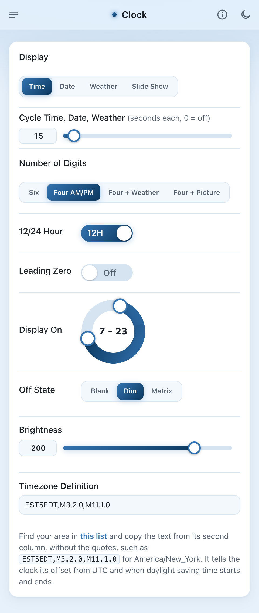 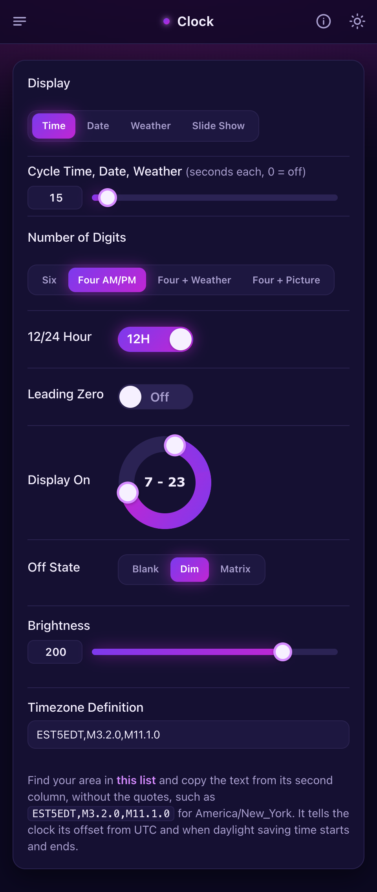

At the top of every page:

* The menu button, on the left, goes to the other pages.
* The **i** button opens the part of this guide for that page.
* The moon or sun button switches between the light and dark themes. Until you use it, the web UI follows your phone's or computer's light or dark setting. After that, the browser remembers your choice.

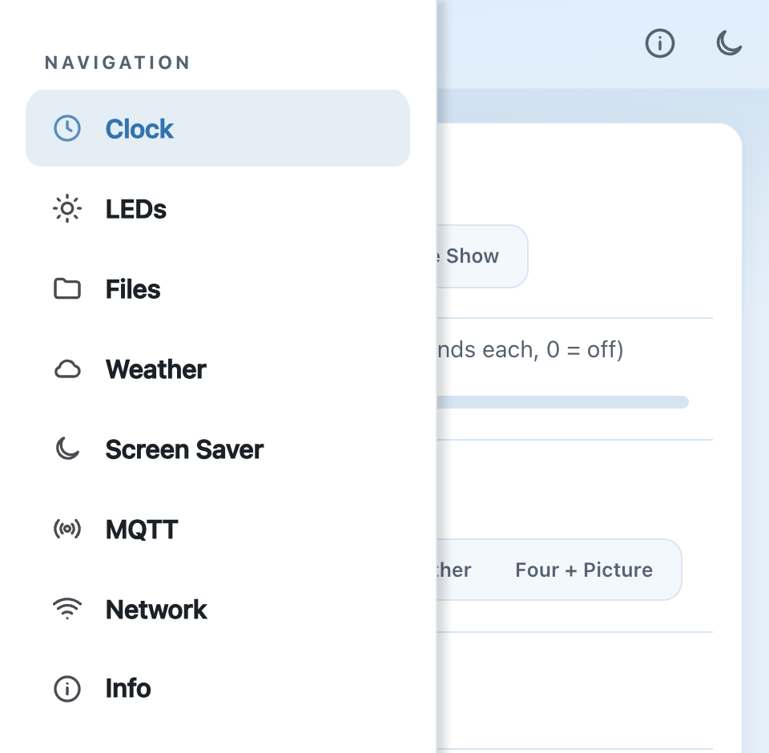

There's no Save button. A change takes effect on the clock straight away, and the clock saves it within a minute, so it's kept when the clock restarts. Changes made with the clock's buttons or from Home Assistant appear in the web UI as they happen.

## Clock

* **Display** chooses what the clock shows: the **Time**, the **Date**, the **Weather** forecast or a **Slide Show** of pictures. The clock's mode button does the same.
* **Cycle Time, Date, Weather** shows each of the time, the date and the weather for this many seconds, then moves on to the next. 0 turns it off. The weather is skipped if there's no OpenWeatherMap API key. A slide show isn't part of the cycle, and gives way to the time.
* **Number of Digits**, **12/24 Hour** and **Leading Zero** are shown when Display is Time:
  * **Six** shows hours, minutes and seconds.
  * **Four AM/PM** shows hours and minutes, a flashing colon, and AM or PM on the last display in 12-hour time.
  * **Four + Weather** shows today's forecast on the last display instead.
  * **Four + Picture** shows a picture from the slide show on the last display instead, changing every 10 seconds.
  * **Leading Zero** shows a 0 before single-digit hours, such as 09:30 rather than 9:30.
* **Date Format** is shown when Display is Date: DD-MM-YY, MM-DD-YY or YY-MM-DD.
* **Display On** sets the hours the displays are on. Drag the two handles. In "7 - 23", the displays come on at 7:00 and go off at 23:00. If the two numbers are the same, the displays are always on.
* **Off State** chooses what the displays do outside those hours: **Blank** turns them off, **Dim** shows the time more dimly, and **Matrix** shows the digital rain animation, in the colors set on the [Screen Saver](#screen-saver) page.
* **Brightness** sets how bright the displays are, from 10 to 255.
* **Timezone Definition** tells the clock its offset from UTC and when daylight saving time starts and ends. Find your area in [this list](https://github.com/nayarsystems/posix_tz_db/blob/master/zones.csv) and copy the text from its second column, without the quotes, such as `EST5EDT,M3.2.0,M11.1.0` for America/New_York.

## LEDs

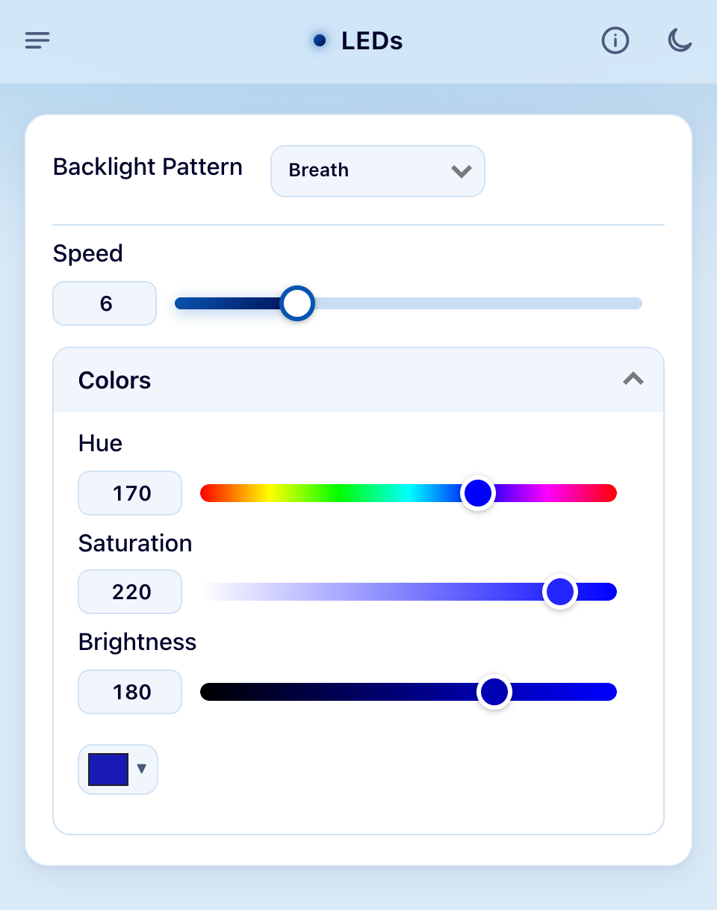

The LEDs light the displays from below.

* **Backlight Pattern**:
  * **Dark** turns them off.
  * **Constant** is one steady color.
  * **Rainbow** moves every color across the LEDs.
  * **Pulse** and **Breath** fade one color up and down, Breath more smoothly.
  * **Aurora** is like Rainbow, with a choice of how different neighboring LEDs' colors are.
* **Speed**, from 1 to 20, is for every pattern except Dark and Constant.
* **Colors Per Led**, from 1 to 10, is for Aurora. Higher numbers make neighboring LEDs' colors more different.
* **Hue**, **Saturation** and **Brightness** set the color, or use the color picker below them. Rainbow and Aurora use every hue, so they don't show Hue.

## Files

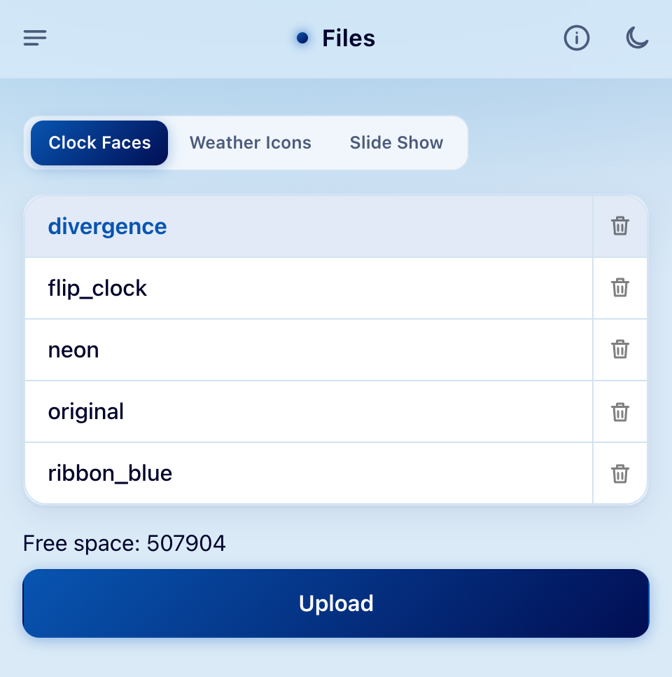

The clock's images come in sets, each in a `.tar.gz` file: clock faces, weather icons and slide shows.

* Choose **Clock Faces**, **Weather Icons** or **Slide Show** at the top to list them. The one in use is highlighted.
* Tap a name to use it. Changing takes a few seconds while the clock unpacks the images, and the displays show its progress.
* **Upload** adds a set from your phone or computer. One with the same name as a set already on the clock replaces it.
* The trash button deletes a set. You can't delete the one in use.
* **Free space** shows how much room is left for more.

You can also choose sets with the [clock's buttons](#clock-buttons), and upload and delete them over MQTT, see [Uploading files over MQTT](../README.md#uploading-files-over-mqtt).

More clock faces are in [more_faces](../more_faces) and at [Spider19996/Tube-Clock-Faces](https://github.com/Spider19996/Tube-Clock-Faces), and more weather icons in [weather_icons](../weather_icons). The clock comes with two slide shows, anime_female and blank. blank is there to free up space if you don't show pictures. To make your own sets, see [Image Collections](https://github.com/judge2005/EleksTubeIPS/wiki/Image-Collections) in the upstream wiki.

## Weather

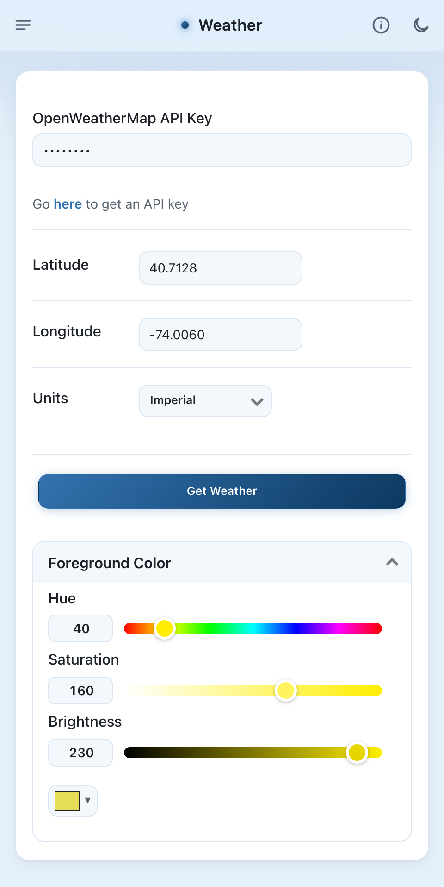

The forecast comes from [OpenWeatherMap](https://openweathermap.org/), and a free account is enough. The clock fetches it every 15 minutes.

* **OpenWeatherMap API Key**: create an account and an API key, and paste it here. Once it's set, the web UI shows dots instead of the key. To change it, type the new one over them.
* **Latitude** and **Longitude** are where the forecast is for, in degrees, such as 40.7128 and -74.0060 for New York. Map apps show them, for example when you right-click a place in Google Maps.
* **Units**: **Imperial** for °F, or **Metric** for °C.
* **Get Weather** fetches the forecast now. The displays take a few seconds to redraw.
* **Foreground Color** is the color of monochrome weather icons, such as the monochrome set, so you can match them to your clock face. Colored icon sets ignore it.

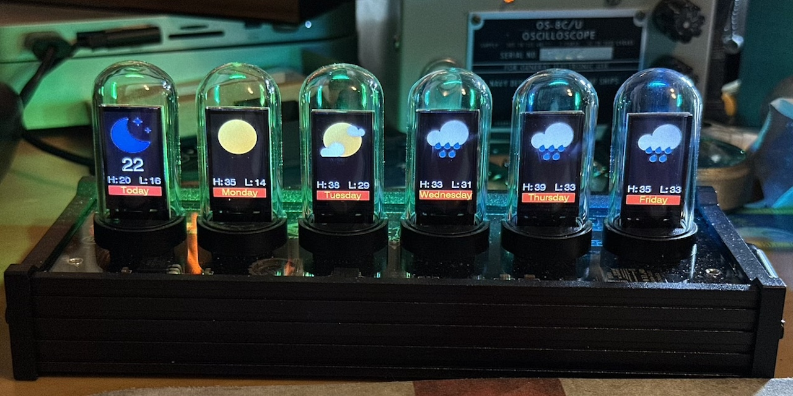

## Screen Saver

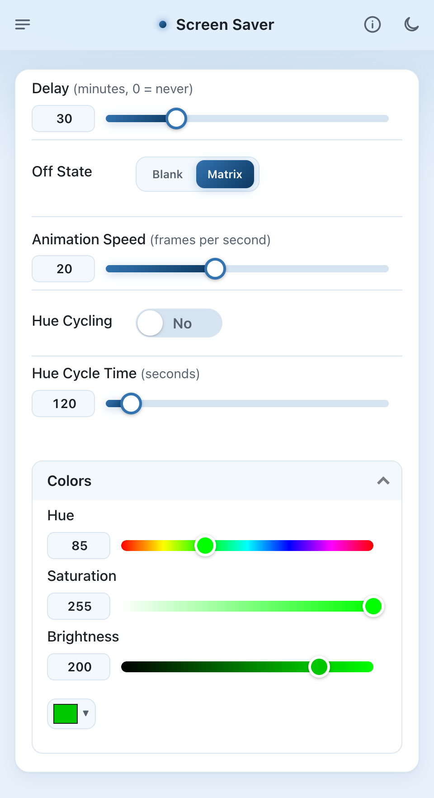

The screen saver starts when nobody has used the clock for a while. Any button on the clock, or any change in the web UI, stops it. To start it straight away, press the clock's power button.

* **Delay** is how many minutes it waits, from 1 to 120. 0 turns the screen saver off.
* **Off State** chooses the screen saver: **Blank** turns the displays off, but not the LEDs, and **Matrix** shows a digital rain animation like the one in The Matrix.
* **Animation Speed**, **Hue Cycling**, **Hue Cycle Time** and **Colors** set up the Matrix animation, here and when the Clock page's Off State is Matrix. Hue Cycling moves the animation's color through every hue, taking Hue Cycle Time seconds for each round.

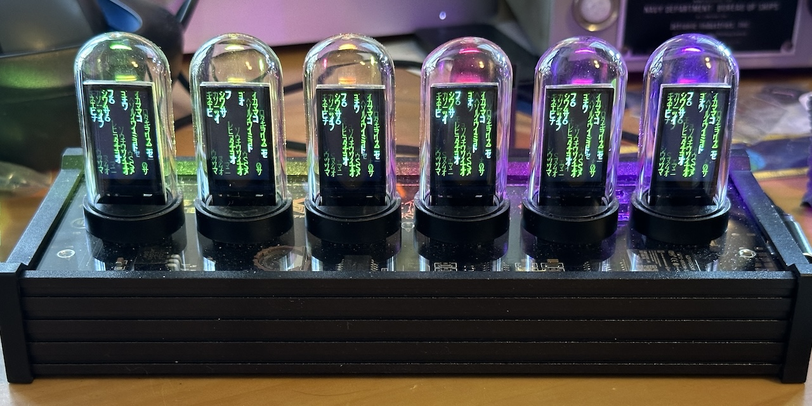

## MQTT and Home Assistant

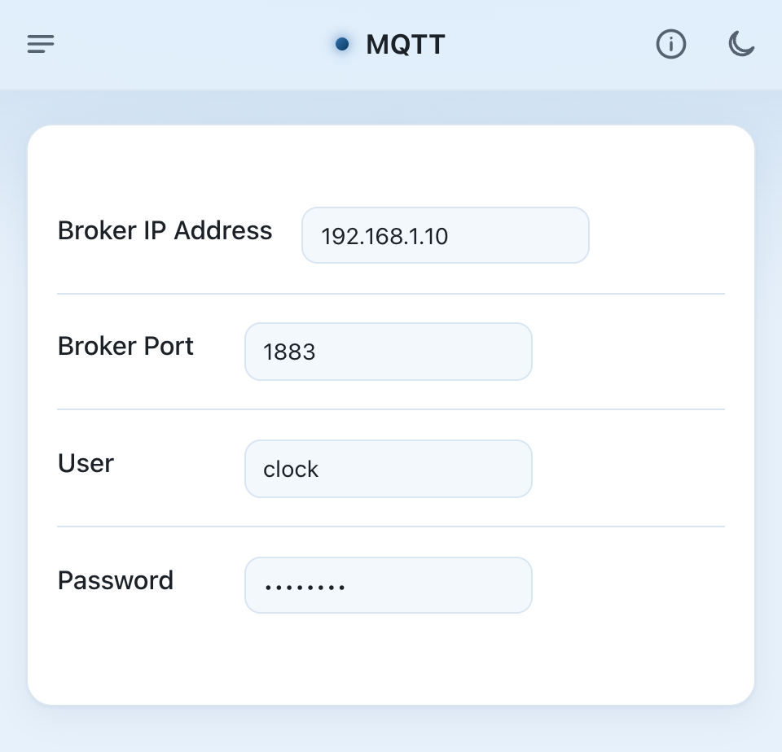

Connect the clock to an MQTT broker, such as Home Assistant's Mosquitto add-on, to control it from Home Assistant or your own scripts.

* **Broker IP Address** and **Broker Port**: the broker's address, and its port, usually 1883.
* **User** and **Password**: the broker's login, if it has one. Once the password is set, the web UI shows dots instead of it. To change it, type the new one over them.

If Home Assistant's MQTT integration uses the same broker, the clock appears in Home Assistant by itself, with almost every setting in the web UI. Everyday ones are listed under Controls, and set-and-forget ones under Configuration.

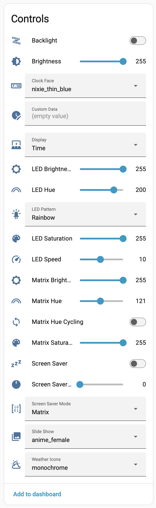 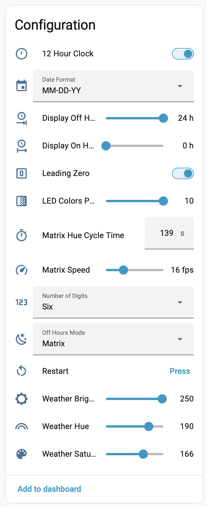

Topics start with `clock/<id>`, where `<id>` is the clock's **MQTT ID** from the [Info](#info) page, such as `A1B2C3elekstubeips`. It doesn't change when you change the hostname.

| Topic | Payload |
|---|---|
| `clock/<id>/set/brightness` | 10 to 255 |
| `clock/<id>/set/display` | 0 for the time, 1 the date, 2 the weather, 3 the slide show |
| `clock/<id>/set/screen_saver` | `ON` or `OFF` |
| `clock/<id>/set/custom` | Up to six characters to show instead of the time, see [Showing your own text](../README.md#showing-your-own-text) |
| `clock/<id>/set/backlight_state` | `ON` or `OFF` |
| `clock/<id>/set/backlight_hs` | Hue from 0 to 360 and saturation from 0 to 100, such as `240,100` |
| `clock/<id>/set/backlight_brightness` | 0 to 255 |
| `clock/<id>/set/restart` | Anything. Restarts the clock. Don't set the retain flag. |

IPSTube clocks have the same three topics for the underlight, such as `clock/<id>/set/underlight_hs`, though it's turned on and off together with the backlight. Every other setting has a topic too, which Home Assistant shows under the entity's **MQTT INFO**.

The clock publishes its state on `clock/<id>/volatile/state` (brightness, display, screen saver, backlight and custom text) and `clock/<id>/persistent/state` (the settings, without passwords or the API key), and `online` or `offline` on `clock/<id>/availability`.

## Network

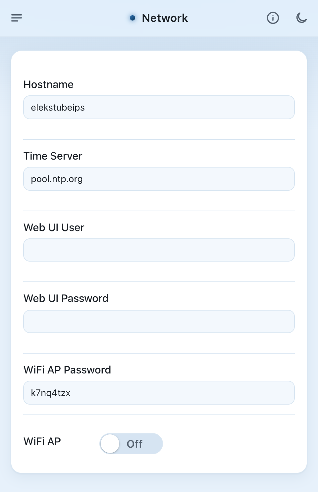

* **Hostname** is the clock's name on your network, so the web UI is at http://*hostname*.local. Give each clock its own. The clock restarts when you change it.
* **Time Server** is where the clock gets the time, by name or IP address, such as a server on your own network. The default is pool.ntp.org.
* **Web UI User** and **Web UI Password** set a login for the web UI. Set both and the clock asks for them before every page, upload and `/custom` request. Clear either one to turn the login off. The user can have letters, digits and `. _ - @`, and the password letters, digits, spaces and punctuation, without accents. Setting or changing the login disconnects any web UI that's open, so reload it and log in. If you forget the login, start the clock where it can't join your Wi-Fi, connect to its access point, choose **Configure Clock** and change it here, since the clock doesn't ask for it over its access point.
* **WiFi AP Password** is the access point's password. Type your own, at least 8 characters, or clear it for a new random one. A new password is used the next time the access point starts.
* **WiFi AP** turns the access point on or off, for example to move the clock to a different network, see [Connecting to Wi-Fi](#connecting-to-wi-fi).

## Info

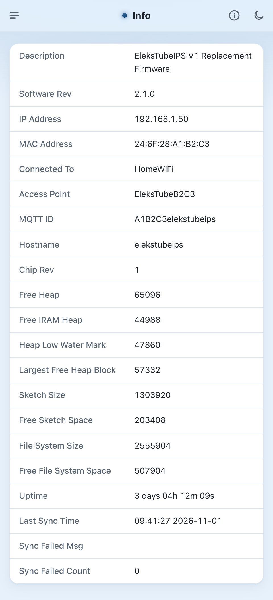

Details of the clock, mostly for troubleshooting:

* **Software Rev** is the firmware version.
* **IP Address**, **MAC Address** and **Connected To**, the Wi-Fi network the clock is on.
* **Access Point** is the name of the clock's access point.
* **MQTT ID** is what the clock's MQTT topics and Home Assistant entities are named after.
* The **Heap** rows show how much memory is free, and the **Sketch** and **File System** rows how much flash.
* **Uptime** is how long since the clock last started.
* **Last Sync Time** is when the clock last got the time from the time server, and **Sync Failed Msg** and **Sync Failed Count** say why and how often that failed.

## Clock buttons

EleksTube and PCBWay PunkCyber clocks have four buttons: left, right, mode and power. The Si Hai has the same four, and the IPSTube has just power. The firmware doesn't use the NovelLife SE's buttons.

When the screen saver is running, pressing any button stops it, and does nothing else.

When the displays are on:

* Press power to start the screen saver.
* Hold power to turn the displays off, until you hold it again or until the next time Display On turns them on.
* Press mode to switch between the time, the date, the weather and the slide show.
* Hold mode for a menu of clock faces, or of weather icons or slide shows when they're showing. Press left and right to move up and down the list, press mode to choose, or hold mode to close the menu without changing anything.

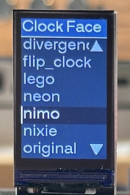

When the displays are off for the night (outside the Display On hours):

* Press any button to show the displays for 10 seconds.
* Hold power to turn the displays back on, until you hold it again or until the next time Display On turns them off.

On the IPSTube, pressing power switches between the time, the date, the weather and the slide show, and holding it works as above.
